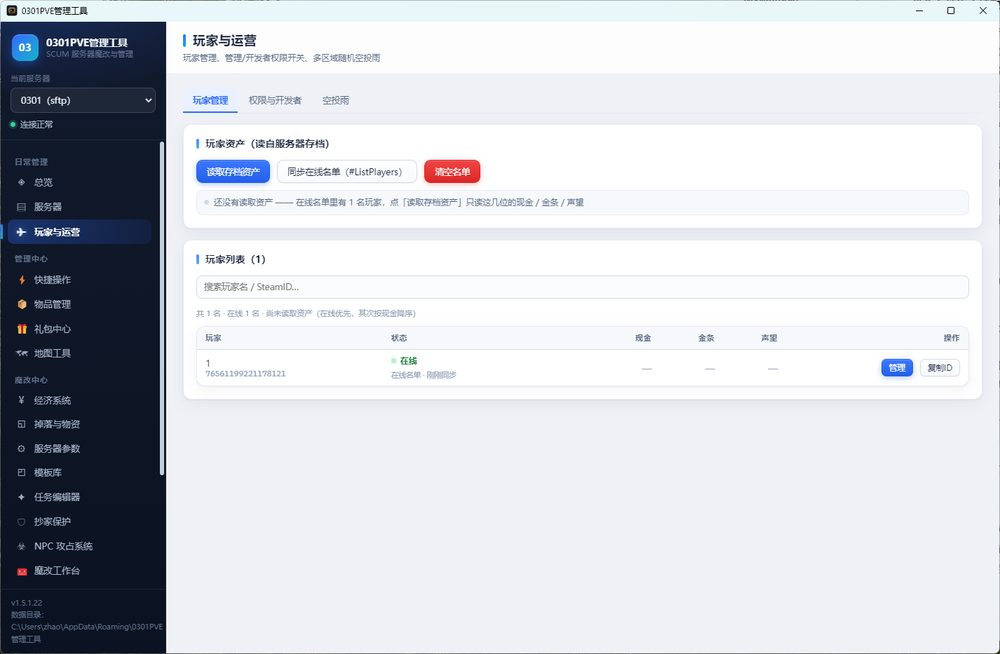
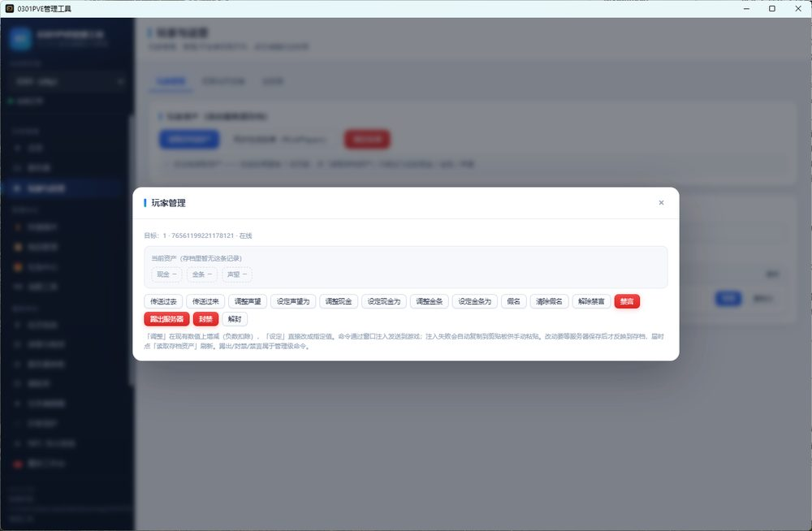
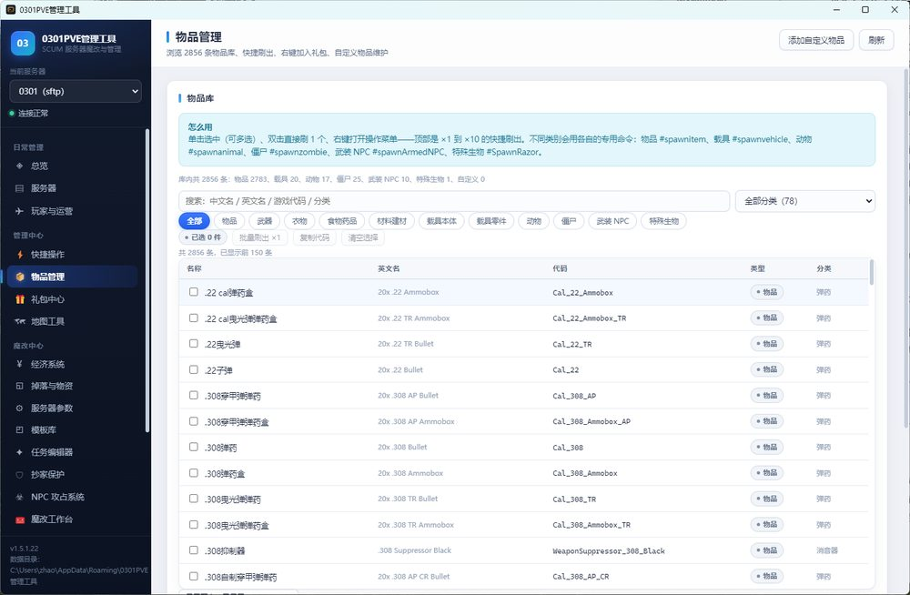
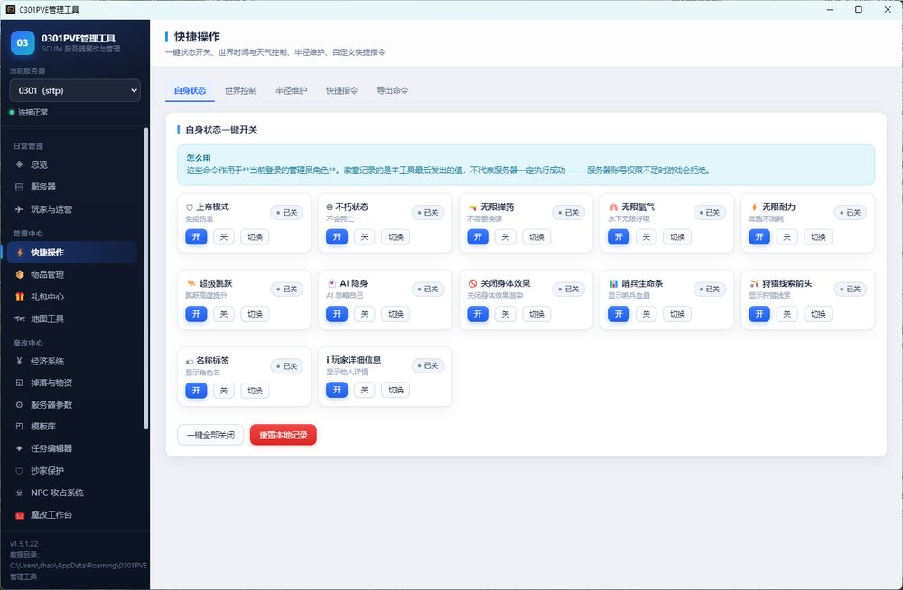
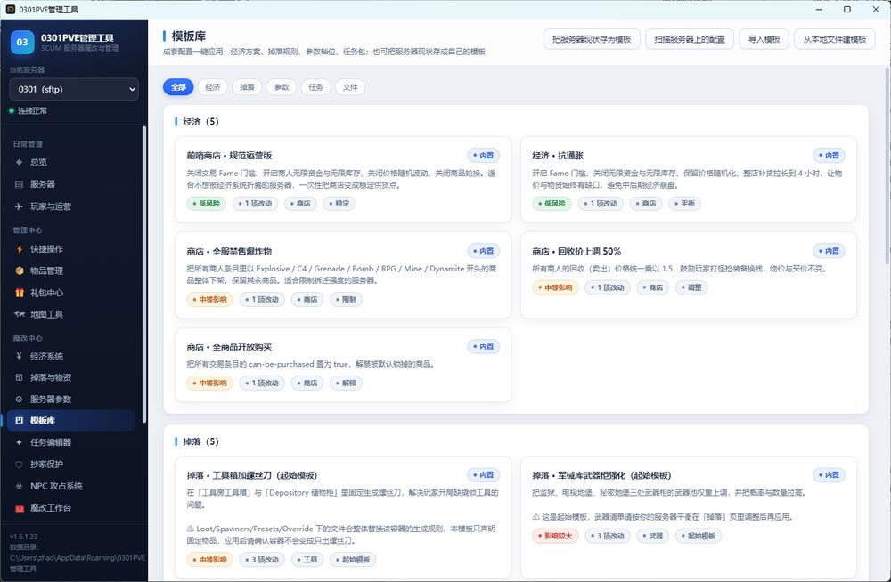

# 0301PVE管理工具 · SCUM管理工具

**改配置不出事** —— 20 个页面，管完整台 SCUM 专用服务器。

> **在线介绍页（推荐，可直接打开）**：https://zhaoxiansheng001.github.io/SCUM0301tool/
> **官网（下载安装包）**：https://0301tool.app.workbuddy.host/?sharecode=ETWJKA4EAL

---

## 这是什么

给 SCUM 私服服主用的桌面端管理工具。经济、掉落、服务器参数、任务、抄家保护、NPC 攻占、地图、礼包、备份、监控——原本要在十几个 ini 和 JSON 之间来回切、改完还得担心格式被洗坏的事，收进一个界面里。

免安装，双击就能跑，不写注册表；本地目录、SFTP、FTP、FTPS 都能连，多台服务器可以一起管。

## 为什么敢改配置

不是「保存了就完事」，每次写入都走同一条链路：

| 步骤 | 做了什么 |
| --- | --- |
| ① 写入前快照 | 改任何一项之前，先给整套 `WindowsServer` 配置打快照，不需要你手动备份 |
| ② 写完回读校验 | 保存后立刻把文件读回来，逐项确认改动真的落盘、格式没坏、注释和行序还在 |
| ③ 失败自动回滚 | 校验不通过自动还原快照，服务器不会停在半改坏的状态；也能在备份页手动回滚任意一份 |

所有改动都留回执：哪一项、什么时候改的、用了哪份快照，都能查到。

## 玩家运营，一键搞定

### 1. 一键获取在线玩家和资产

在线名单一键拉取，现金 / 金条 / 声望一次读齐，点「管理」直接进入单个玩家的操作面板。

### 2. 便捷修改玩家数据

调整现金、金条、声望，传送 / 踢出 / 封禁一点即发，不用再敲一长串命令。

### 3. 毫秒级刷物品速度

内置 2856 条物品库，中文名直接搜，双击出命令，x1 到 x10 数量快捷切换；物品 / 载具 / 动物 / 僵尸全类型覆盖。

### 4. 快捷操作常用命令

自身状态 12 项一键开关，世界时间天气、半径维护、传送随时点，常用指令不用背。

### 5. 超多魔改模板

内置经济 / 掉落 / 参数 / 任务多套魔改模板，一键套用；也能把当前服务器配置存成模板，换服直接复用。

## 一个界面，管完整台服

20 个视图 / 39 个标签页，从日常运维到魔改配置都在同一套界面里。

| 模块 | 能做什么 |
| --- | --- |
| 经济系统 | 商人按 A→Z 区排序，价格、上下架、声望门槛可视化；2736 条官方买卖价内置；批量调价、按前缀批量下架、一键无限资金 |
| 掉落与物资 | 生成器预设、容器规则、区域掉落倍率；机场、空军基地、海军基地等百倍热点一键 10/25/100 倍 |
| 服务器参数 | 14 项已验证倍率与四档预设，改完保留注释、行序、编码与换行风格，不会把 ini 洗成乱码 |
| 任务编辑器 | 图形化编商人任务、Tier、奖励池与三类条件；批量部署，可一键屏蔽官方原版任务 |
| 抄家保护 | 九项参数可视化，全局突袭时段按北京时间填，服务器是 UTC 会自动换算，跨午夜也能拆对 |
| NPC 攻占 | 批量部署丧尸、动物、哨兵；勾选分区生成攻占计划，逐区传送并按数量刷怪 |
| 地图与礼包 | D4→Z0 二十五格取点，空投、传送、坐标本；礼包中心点选组包，SteamID64 严格校验 |
| 快捷操作 | 自身状态 12 项开关、世界时间与天气、半径清理、传送；常用指令可一键复制成批 |
| 备份与监控 | 一键快照、逐文件差异、整体或单文件回滚；进程面板、注入状态、在线玩家、日志尾部实时看 |
| 魔改工作台 | 把整套改法串成流水线，逐项返回结果，一项失败不会把后面的搅乱 |

## 近期更新

**V1.5.1.27** 稳定性与性能优化 —— 修复监控页离开后定时器仍在后台空转的问题（视图切换即停）；
日志刷新改为只拉文件尾部 256KB，日志没更新时零网络流量；20 个视图改为按需加载，冷启动更快；
物品库搜索加 150ms 防抖，连续输入不卡。配置读写、备份回滚链路与 1.5.1.26 完全一致，直接覆盖升级即可。

## 程序加固

- **改动即失效**：安装包内置 asar 完整性校验，程序主体被改动任何字节都会直接拒绝启动（实测翻转 1 bit 即终止，窗口都不会出现）。
- **字节码分发**：主进程 36 个模块编译为 V8 字节码，安装包里没有可直接阅读的主进程源码。
- **资产加密**：物品库（2856 条）与商人价格目录以 AES-256-GCM 加密存储，不是可以双击导出的明文 JSON。
- **授权验证在主进程**：改配置、刷物品、下发指令、备份还原等 38 个写入通道统一在主进程校验，改界面遮罩绕不过去。

## 下载安装

**方式一（推荐）**：打开官网点「下载安装包」
https://0301tool.app.workbuddy.host/?sharecode=ETWJKA4EAL

**方式二**：GitHub Releases 下载
- 直连（海外 / 能正常访问 GitHub）：[Releases 页面](https://github.com/zhaoxiansheng001/SCUM0301tool/releases/latest)，附件 `0301PVE-1.5.1.27.exe`（约 66 MB）
- 国内加速通道：<https://ghfast.top/https://github.com/zhaoxiansheng001/SCUM0301tool/releases/download/v1.5.1.27/0301PVE-1.5.1.27.exe>

> 附件名可能随版本变化；如果加速通道也失效，用上面第一条的 Releases 页面。

安装包未做代码签名，Windows 首次运行可能提示「已保护你的电脑」——点「更多信息 → 仍要运行」即可。免安装，不写注册表，删掉文件就是卸载。

**系统要求**：Windows 10 / 11 64 位，无需安装 .NET 运行时或 Node 环境。

## 连接服务器

| 方式 | 适用场景 |
| --- | --- |
| 本地目录 | 单机开服、映射网络盘 |
| SFTP | 远程 Linux 服务器（推荐） |
| FTP | 只开了 FTP 的面板服，按区块读取 |
| FTPS | 要求加密连接的服务商 |

不知道服务器根目录在哪，点「自动探测根目录」会自己扫常见路径。

## 常见问题

**会不会被官方封？**
工具只读写你自己服务器的配置文件，不修改游戏客户端、不改内存、不注入别人的服务器。和你用 FTP 改配置是同一类操作。

**支持正版服 / 远程服吗？**
支持，只要能拿到服务器目录权限就能用。

**存档很大也能读玩家资产吗？**
能。远程是在服务器端查询完只回传结果（约 34 KB），本地按页读、不整份加载，FTP 按区块取，通常只拉几 MB。

**改坏了怎么办？**
每次写入前自动快照，校验失败自动回滚；备份页能看到所有快照、按文件对比差异、整体或单文件回滚。

**SCUM 没有 RCON，怎么发全服指令？**
走游戏内控制台窗口注入发送，提权不一致时会明确告警，避免消息被系统静默丢弃。

**需要买卡密吗？**
有试用卡，具体加作者 QQ 领取。

## 说明与免责

- 本工具仅用于**管理自己的 SCUM 专用服务器**，只读写服务器配置文件、只读解析存档，不修改游戏客户端、不改内存、不向他人服务器注入。
- 请自行评估所在服务器与社区规则；因使用本工具产生的后果由使用者承担。
- SCUM 为 Gamepires 注册商标，本项目与其无隶属关系，也未获其背书。
- 本仓库不提供游戏本体或任何破解内容。

## 联系作者

- QQ：**1264576356**（问题反馈 / 领试用卡）
- 官网：https://0301tool.app.workbuddy.host/?sharecode=ETWJKA4EAL

---

如果这个工具帮你省下了几个通宵，点个 ⭐ Star 让更多服主看到。
